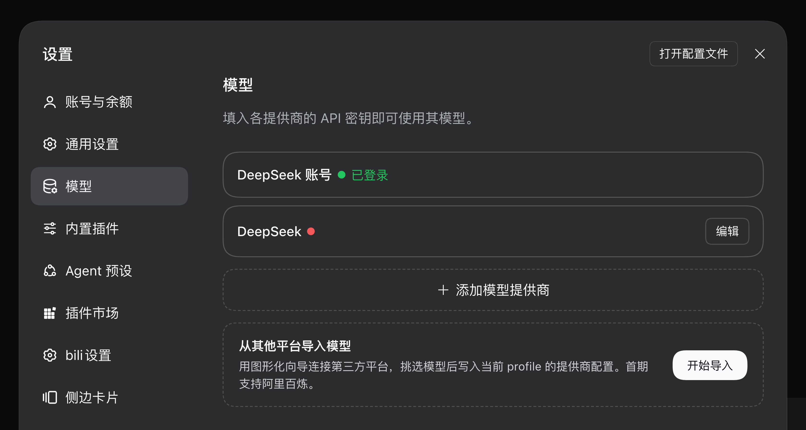
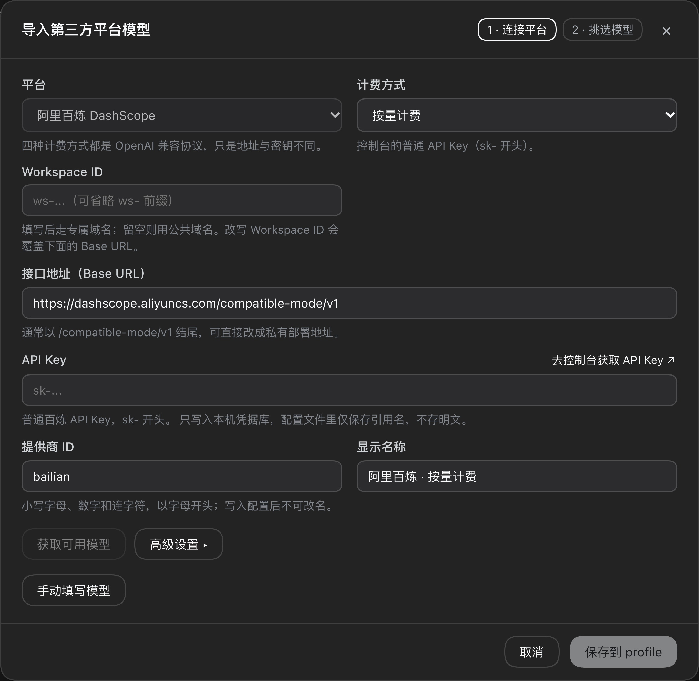
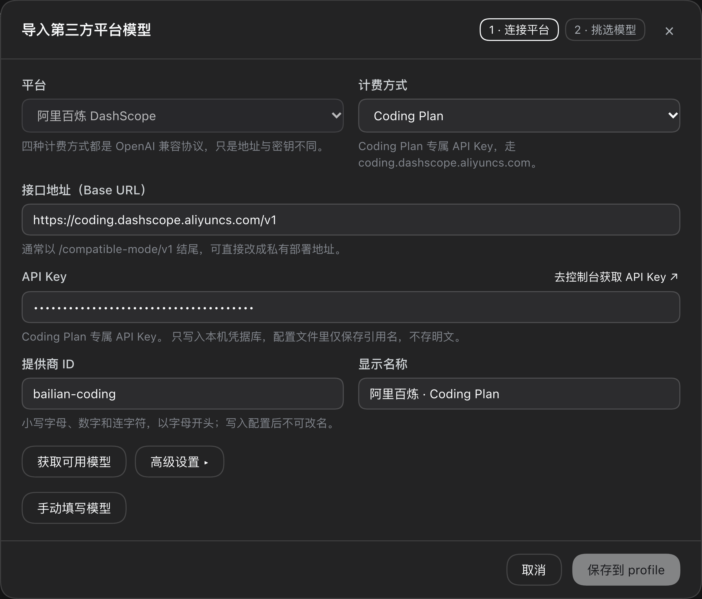
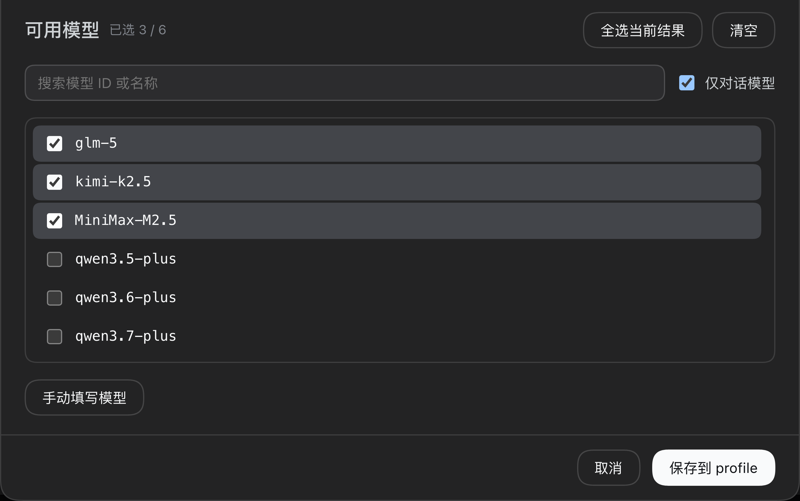

<!--
掘金发布信息（这段是 HTML 注释，渲染后不可见）

标题：给 DSH 写了个插件：三步把阿里百炼的模型导进设置页
摘要：DSH 的模型设置里接阿里百炼，要手填 Base URL、Provider ID 和一长串模型 ID。这个插件把这件事变成一个向导：选计费方式 → 贴 Key → 点「获取模型」→ 勾选保存。附四种计费方式对照表与实现拆解。
标签：AI、开源、前端、JavaScript、DeepSeek
封面图已生成：`images/cover.png`（1200×630）。正文截图在 `images/` 下，都是深色主题真机截图；粘贴到掘金编辑器后需要重新上传一次图片（本地相对路径不会生效）。
-->

# 给 DSH 写了个插件：三步把阿里百炼的模型导进设置页

## 先说痛点

我日常用 DeepSeek Harness（下称 DSH）当主力客户端。它自带一个「设置 → 模型」页面，能接 DeepSeek 官方、也能接第三方 OpenAI 兼容服务，逻辑是清楚的：一个提供商对应一条配置，配置里是一组模型。

问题出在「阿里百炼」上。

百炼不是「一个地址 + 一个 Key」那么简单，它按计费方式分了至少四套入口：

- 按量计费，走 `dashscope.aliyuncs.com`，或者你自己 Workspace 的专属域名；
- Coding Plan，走 `coding.dashscope.aliyuncs.com`；
- Token Plan 个人版 / 团队版，走 `token-plan.cn-beijing.maas.aliyuncs.com`。

每套的 Base URL 不同、Key 的申请入口不同、Key 的前缀也不同（`sk-` / `sk-sp-` 之类）。填错一个字符，表现就是 401 或者「模型不存在」，而且报错信息不会告诉你到底错在哪。

更要命的是模型列表。百炼有上百个模型，`qwen3-max`、`qwen-plus`、`qwen-turbo`、`qwen3-coder-plus`、`text-embedding-v4`……你得一个个手抄进配置里，抄错一个 ID，那个模型就用不了；想只留几个常用的，还得反复翻文档核对名字。

所以我写了个插件 **dsh-model-importer**，把这件事做成一个向导。

## 它做了什么

一句话：**在「设置 → 模型」页最底部加一张卡片，点开是三步向导，选计费方式、贴 Key、勾模型，保存。**

具体来说：

1. **计费方式内置**：四种模式各带正确的 Base URL、默认 Provider ID（`bailian` / `bailian-coding` / `bailian-tpp` / `bailian-tp`）、以及对应控制台的 Key 申请入口，不用再记。
2. **自动拉模型列表**：填完 Key 点「获取模型」，直接请求该地址的 `/models`，把能用的模型列出来（接口给了上下文长度就一并显示），默认只显示对话模型，embedding、rerank、TTS、OCR 这些默认折叠掉。
3. **勾选即写入**：选中哪些就写哪些，自动补上上下文窗口和最大输出；Provider ID 撞了会自动加 `-2`；Key 存成凭据引用，配置文件里不落明文。
4. **顺手能跳转**：API Key 输入框旁边有个「去控制台获取 API Key ↗」，点了用系统浏览器打开对应计费方式的 Key 页面。



## 装它

DSH 的插件是 npm 上的组合包（bundle），装法有三种，选一种就行。

**图形界面**：左侧「插件」→ 右上角「添加插件」→ 粘贴 `dsh-model-importer` → 安装（安装源保持默认的「中国大陆镜像源」就行）。

**命令行**（装了 dsh CLI 的话）：

```sh
dsh plugin add dsh-model-importer
```

**本地包**（比如你拿到的是我发的 tgz）：

```sh
dsh plugin add ./dsh-model-importer-0.2.4.tgz
```

装完有一个必须做的动作：**刷新页面**（⌘R / Ctrl+R）。

原因不是偷懒，而是 DSH 客户端有意为之：页面启动时会锁定自己这一代的客户端模块图（`window.__DSH_BOOT__.entries`），之后只应用同一 release 的图。插件是热装载进宿主了，但当前页面不会凭空长出新的 UI，刷新一次才会加载新的模块图。我第一次装完也盯着屏幕等了几秒，以为没生效。

## 用它

刷新后，**设置 → 模型**，滚到最底下，会多一张卡片：**导入第三方平台模型**。

点「开始导入」，弹窗里三步。

**第一步，选计费方式。** 选完 Base URL 会自动填好；只有「按量计费 + Workspace 专属域名」这一种会多出一个 Workspace ID 输入框（可以省略 `ws-` 前缀，留空就走公共地址）。



**第二步，贴 Key。** 输入框右上角就是「去控制台获取 API Key ↗」，点了跳系统浏览器，不会把你正在用的 DSH 界面顶掉。



**第三步，获取并勾选模型。** 点「获取可用模型」，等一两秒出列表，支持搜索、全选、清空；接口没列出来的模型也能手动补一行 ID。确认后保存，卡片上会回显「已添加 N 个模型」。



然后回「模型」页，你会在提供商列表里看到新加的一条，选个模型就能开聊了。

## 四种计费方式对照表

这张表是我照着百炼文档一个地址一个地址核对出来的，直接存下来比每次翻文档快。

| 计费方式 | Provider ID | Base URL | Key |
| --- | --- | --- | --- |
| 按量计费 | `bailian` | `https://dashscope.aliyuncs.com/compatible-mode/v1`，或 `https://{WorkspaceId}.cn-beijing.maas.aliyuncs.com/compatible-mode/v1` | 百炼控制台 API-KEY，`sk-` 开头 |
| Coding Plan | `bailian-coding` | `https://coding.dashscope.aliyuncs.com/v1` | Coding Plan 专属 Key |
| Token Plan 个人版 | `bailian-tpp` | `https://token-plan.cn-beijing.maas.aliyuncs.com/compatible-mode/v1` | `sk-sp-` 开头 |
| Token Plan 团队版 | `bailian-tp` | 同上 | 团队版专属 Key |

API 协议统一是 `openai-completions`。

如果你暂时不想装插件，也可以走 DSH 原生的「自定义模型 API」：设置 → 模型 → 添加提供商 → 选「自定义模型 API」，把这几个值填进去，模型列表手动写。插件省掉的只是「手抄 + 校验」这段体力活，能力边界是一样的。

## 它是怎么实现的

既然发在掘金，把实现摊开讲讲，对想给 DSH 写插件的人应该有点用。

### 一个 DSH 插件长什么样

DSH 的插件包是普通的 npm 包，靠 `package.json` 里的 `dsh` 字段声明自己是组合包：

```json
{
  "name": "dsh-model-importer",
  "type": "module",
  "main": "index.js",
  "exports": { ".": "./index.js", "./client": "./client.js" },
  "dsh": {
    "manifestVersion": 1,
    "bundle": { "patch": "./cordis.patch.yml" },
    "client": { "platform": "web", "inject": ["@deepseek-ai/dsh-client-locale", "@deepseek-ai/dsh-client-ui-slots"] }
  }
}
```

- `dsh.bundle.patch` 指向一个 patch 层，宿主安装时把它插进自己的配置图：

```yaml
- insert:
    - id: model-importer
      name: dsh-model-importer
```

- `dsh.client` 声明这是 Web 端插件，需要用到 locale 和槽位服务。

宿主侧（`index.js`）我一行逻辑都没写，因为所有工作都在客户端：`export function apply() {}`。

### 客户端模块：一个自己管自己的工厂

`exports["./client"]` 指向的文件不是普通 ESM，而是 DSH 约定的模块格式：

```js
window.__ModuleLoader__.load({
  id: 'dsh-model-importer',
  factory(require) {
    const React = require('react')
    return {
      inject: ['slots', 'locale', 'remote', 'remote.settings', 'remote.llm', 'remote.credentials'],
      apply(ctx) {
        // 注册 UI
      },
    }
  },
})
```

`require` 只能拿到宿主 seed 进模块表的包（react、react-dom、cordis、ui-slots 等少数几个），拿别的会直接抛「missed the module table」。这也意味着**不用打包、不用构建**，手写一个 JS 文件就能发。

### 挂到模型页底部

我要的入口是「模型」页最下面，所以挂的是模型页声明的一个列表槽：

```js
ctx.effect(() =>
  ctx.slots.inject('settings.models.footer', () =>
    ctx.slots.register(
      { name: 'settings.models.footer', id: 'dsh-model-importer', order: 40 },
      ModelImporterCard,
    ),
  ),
)
```

DSH 的槽位有类型（`single` / `list` / `keyed`），`settings.models.footer` 是 `list`，意思是「谁想加都行，按 order 排」。插件卸载时 `ctx.effect` 自动清理注册，不会留僵尸 UI。

### 读配置、拉模型、写回去

DSH 插件不直接读写磁盘，走的是宿主给的 remote 接口，三个都用到了：

```js
// 1. 读：拿到 llm-pi-ai 这一命名空间的当前值 + revision
const doc = await ctx.remote.settings.describe()
const ns = doc.namespaces.find(n => n.ns === 'llm-pi-ai')

// 2. 探测：把这个地址下能用的模型拉出来
const res = await ctx.remote.llm.discoverModels('llm-pi-ai', {
  baseURL,
  api: 'openai-completions',
  apiKey,
})

// 3. 写：先存 Key，再按路径改配置
await ctx.remote.credentials.set('BAILIAN_API_KEY', apiKey)
await ctx.remote.settings.mutate('llm-pi-ai', [
  { op: 'set', path: ['providers', id, 'displayName'], value: name },
  { op: 'set', path: ['providers', id, 'api'], value: 'openai-completions' },
  { op: 'set', path: ['providers', id, 'baseURL'], value: baseURL },
  { op: 'set', path: ['providers', id, 'apiKeyEnv'], value: 'BAILIAN_API_KEY' },
  { op: 'set', path: ['providers', id, 'models'], value: models },
], ns.revision)
```

几个设计点值得说：

- **凭据不落明文**。`credentials.set` 把 Key 存进 DSH 的凭据库，配置文件里只留一个引用名 `apiKeyEnv`。所以你把配置同步到别的机器，Key 不会跟着跑出去。
- **写配置是路径操作**，不是整块替换。`{ op: 'set', path: [...] }` 只动指定的键，别的提供商配置原样保留。想删一条就发一个 `unset`。
- **写入要带 revision**。并发改配置会返回 `settings/conflict`，我这边做了最多三次「重新 describe → 重算 → 再写」的重试，不会把用户已经改好的东西覆盖掉。
- **探测不用先存 Key**。`discoverModels` 支持直接在请求里带 `apiKey`，所以「先试能不能连通，再决定保不保存」这种体验是成立的。

### 两个前端坑，和 DSH 无关但很典型

**坑一：`position: fixed` 被祖先的 `transform` 劫持。**

我的弹窗原本挂在槽位内联渲染，结果在某些布局下整个弹窗跑出了视口。原因是 CSS 规范：祖先只要有 `transform` / `filter` / `contain`，`position: fixed` 的包含块就从视口变成那个祖先。我把弹窗用 `createPortal` 挂到 `document.body` 才彻底解决：

```js
const createPortal = require('react-dom').createPortal
return createPortal(overlay, document.body)
```

**坑二：flex 容器会「压扁」子项，而不是让容器滚动。**

模型列表放在一个 `flex: 1; overflow: auto` 的纵向 flex 容器里。按直觉给了列表 `flex: 1` 让它占满剩余空间，实测反而被压到只剩几行高——因为 flex 子项默认 `flex-shrink: 1`，内容变多时浏览器优先压缩子项。正确写法是容器上 `min-height: 0`，子项 `flex: 0 0 auto`，列表自己设 `max-height` 和 `overflow-y: auto`：

```css
.dsh-mi-body { flex: 1; min-height: 0; overflow-y: auto; }
.dsh-mi-body > * { flex: 0 0 auto; }                     /* 关键：不许压 */
.dsh-mi-models { max-height: min(52vh, 460px); overflow-y: auto; }
```

顺带一提，弹窗里没有引任何组件库，全是原生 React 元素 + CSS 变量（`--dsw-alias-*`），这样在深色/浅色主题下都能自动适配，也不用担心宿主 UI 库的 API 变动。

## 已知的限制

- **只支持阿里百炼**。代码里 `PLANS` 是个数组，加别的平台本质上是加一条配置，但各家计费方式/地址规则不一样，没有硬套。
- **模型能力字段靠推断**。`/models` 返回的东西各家不一，上下文长度缺失时用默认值（131072 / 8192），可以在向导里手动改。
- **不做模型名映射**。百炼返回的 ID 就是 DSH 里显示的 ID，没做「友好名」这一层。
- 团队版 Token Plan 的 Key 申请页我没找到文档明确给出的独立入口，跳的是订阅总览页。

## 链接

- npm：https://www.npmjs.com/package/dsh-model-importer
- GitHub：https://github.com/ZZUGeneral/dsh-model-importer （MIT，欢迎 issue / PR）

如果它帮你省了十分钟，去 GitHub 点个 star 就是最好的反馈。要是你在别的平台上也有同样的「地址多、模型多、Key 还分种类」的烦恼，可以在 issue 里说一声，我把 `PLANS` 的扩展点整理成文档。
